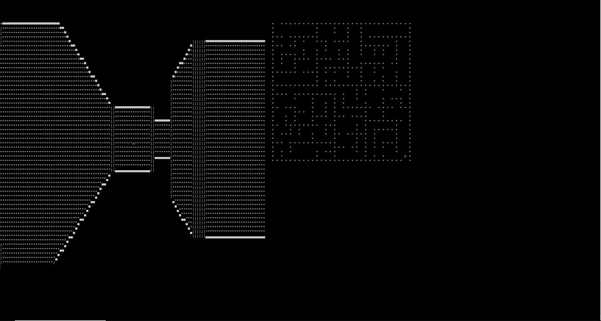
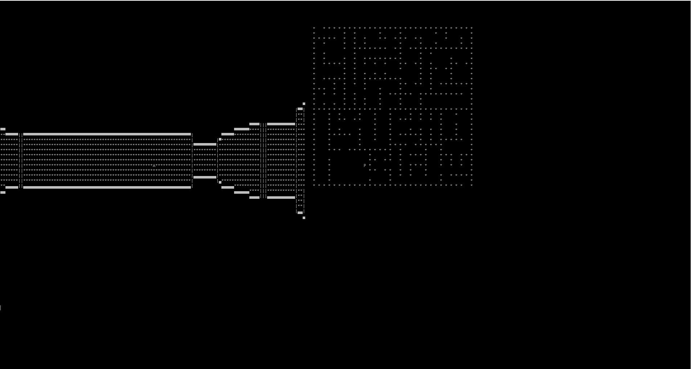
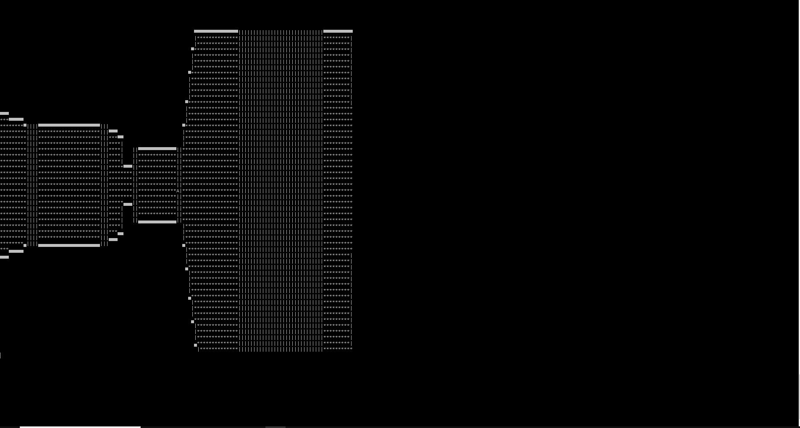

# 2.5D Maze Simulation

## Description

This is a small "game" I made in my spare time. It's a first person Maze runner, completely playable in the terminal. It is made purely in C.

## Visuals




### How to play the game

Before entering the maze you can decide to play with or without map, but its recommended to play with map
- WASD for moving
- Left/Right Arrow for turning

### Goal of the game

There isn't really a goal, mostly to just walk around. You always start at the bottom right of the maze and the game also ends if you reach the top left corner.

### How to build

This project uses GCC 16.1.0 or newer and GNU Make.
Download the project and use in the directory:
```bash
make
```
or just use the main.exe file.

## Inspiration

- The structure was inspired by the rendering style of old DOOM games, This post helped me alot in the creation https://drobnic.dev/writing/raycasting-1/
- The visuals I was inspired of to make this game in the terminal was donut.c, even though mine doesn't look as sick : https://www.a1k0n.net/2021/01/13/optimizing-donut.html
- The Algorithm for the maze generation is : https://weblog.jamisbuck.org/2011/1/12/maze-generation-recursive-division-algorithm

## Further thoughts

This section down is mostly for myself and my process of making it.
- At first I meant it to not have a map at all, but it really is hard navigating it without a layout, as because of the low resolution the view can sometimes become messy
- At first I also printed the Maze layout in a seperate file, if you either get missing or stuck, but even then just location position further in is hard, feature is still in there, as the produced picture looks cool imo
- I also wanted to make it an endless game, where whenever you eneter the finish tile, you get set at the start of a new maze, but I got kinda bored (might do this one day)
- I used recursive division,because it is great for not only having corridors, but also some rooms, even though I had to rewrite it, because it is not originally meant for whole tiles but rather every tile is walkable but you set walls on sides of each tile (like on north,east,south or west of the tile).  


### Why I made this

This game is not fun. Sometimes i feel very tired/bored of everything around me. I tried to encapsulate that feeling of nothingness in this game.


